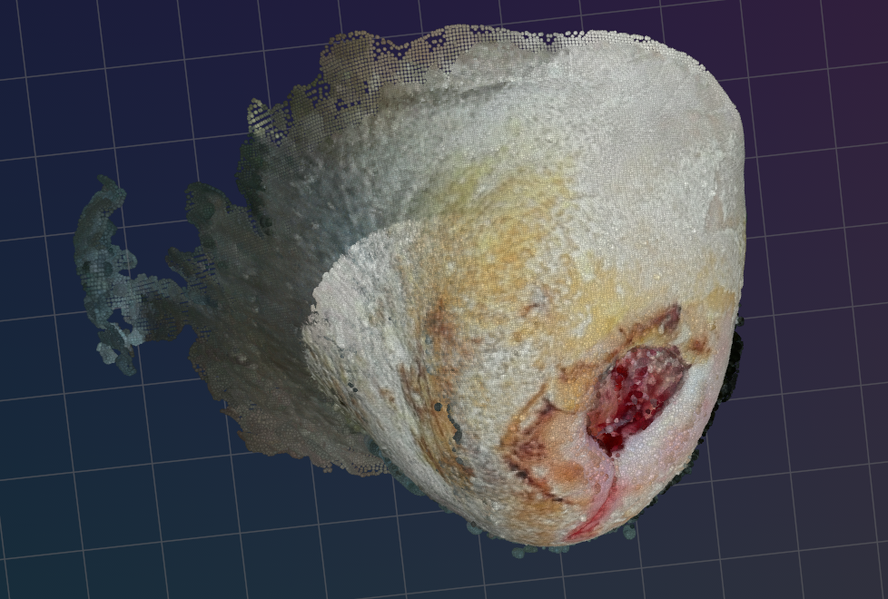
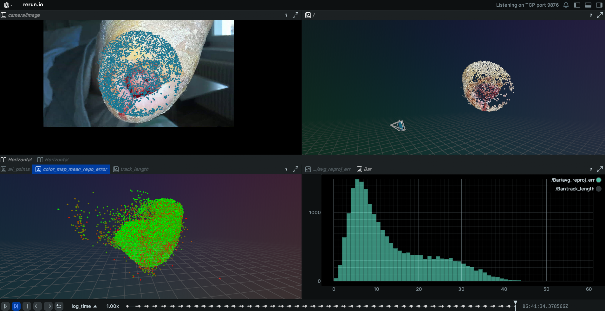

## Conservative Glomap Workflow for Wound Segmentation and 3D Reconstruction

An SfM (Structure from Motion) pipeline is needed to systematically process multiple images and reconstruct a 3D scene while ensuring accuracy and robustness. 
It provides a structured workflow for key steps such as feature extraction, matching, camera pose estimation, sparse reconstruction, and dense reconstruction. This Git repository offers a handcrafted SfM Pipeline for a 3D wound reconstruction which gives the user all options for obtaining a 3D sparse, dense or mesh reconstruction out of a provided Video. The Pipeline was optimized for medical wound image reconstrcution.


### Pipeline Components

1. **Video Analysis/Processing**
    - `Pipe_Code\prepare_vid_for_colmap_v5.py`: Decomposes video into images and selects images based on sharpness and equidistance.
    - `Pipe_Code\build_masks.py`: Automatically creates masks using thresholding in LAB-colorscale.


2. **COLMAP/SFM Pipeline**
    - Parameters can be specified through a project file.
        - Automatic creation of a project file where parameters and settings are specified.
        - The change of parameters is presented to the user in a text editor
            - List of parameters:
                - segments, resize_factor (main.py)
                - min_sharpness_percentile (prepare_vid_for_colmap_v5.py)
                - List of Parameters given in project.ini files
        - Alternatively, execute the COLMAP pipeline with predefined standard values 
    - Save results in the standard COLMAP folder structure as sparse.
        - Output workspace structure:
```
        --  Workspace
            |   database.db
            |   glomap_config.ini
            |   pipeline_times.log
            |   project.ini
            |   TempProject.ini
            |   TotalProject.ini
            +---raw_images    
            +---sharp_images
            \---sparse
                \---0
                        cameras.bin
                        images.bin
                        points3D.bin
```              

    - For each execution the main.py: saving relative Parameters in sqlite3 Database "Trial.db"

3. **Post-Processing**
    - After the sparse reconstruction:
        - The sparse point cloud is filtered in the `rerun_viewer.py` script based on:
            - **Color**: Points with invalid or missing color information are removed.
            - **Reprojection Error**: Points with high reprojection error are excluded to improve accuracy.
            - **Distance**: Points that are too far from the center of the point cloud are filtered out to remove outliers.
        - The filtered point cloud is visualized using the Rerun viewer, providing insights into the quality of the reconstruction.

4. **MVS (Multi-View Stereo)**
    - The dense reconstruction is performed using COLMAP's MVS pipeline:
        - **Image Undistortion**: Prepares images for dense reconstruction by undistorting them.
        - **Patch Match Stereo**: Computes dense depth maps for each image.
        - **Stereo Fusion**: Combines depth maps into a dense point cloud.
    - If masks are provided, they are used during the stereo fusion step to exclude unwanted regions from the dense reconstruction.

5. **Meshing**
    - After the dense reconstruction, a 3D mesh is generated using COLMAP's Poisson meshing:
        - The dense point cloud (`fused.ply`) is used as input.
        - The output is a watertight mesh (`poisson.ply`) that can be used for visualization or further processing.
    - This step ensures a smooth and continuous surface representation of the reconstructed scene.

6. **Visualization**




### Features of the Glomap Pipeline in `main.py`


- **User Input**: Allows user to input video path and workspace path.
- **Workspace Creation**: Creates a structured workspace directory with subfolders for raw images, sharp images, masks, sparse, and dense data.
- **Video Pipeline**: 
    - Extracts images from video.
    - Selects sharp and equidistant images.
    - Optionally processes images to create masks.
- **COLMAP Pipeline**:
    - Executes COLMAP commands for feature extraction, feature matching, and mapping using temporary project files.
    - Appends the data from temporary project files to a total project file (`total_project.ini`).
- **Analysis**: Analyzes the output of the COLMAP pipeline.
- **Rerun Streaming**: Rerun the COLMAP pipeline for visualization.
- **Timing Analysis**: Logs the elapsed time for each step of the pipeline and calculates the total elapsed time.
- **Database Integration**: Loads existing experiments into a database with details such as experiment description, project file, cameras, images, 3D points, observations, mean reprojection error, mean track length, mean observations per image, resize factor, fraction of images, and elapsed time.

### Visualization

The visualization of the trial is achieved via the Rerun viewer.



## How to Use

Follow these steps to set up and run the pipeline:

**NOTE:** Most common SfM-Pipelines make use of Nvidia's CUDA. Make sure that your system supports CUDA and has the 
required properties

### 1. Clone the Repository
Copy the repository to your local machine:
```bash
git clone https://pm-gitlab.intranet.inp-greifswald.de/pqk/colmap_test.git
cd COLMAP_Pipline
```

### 2. Install Dependencies
Ensure you have the required dependencies installed. Before installing the dependencies, make sure that you are familiar with a virtual environment and know how to set it up.
Use the following commands to set up the environment:
```bash
pip install -r requirements.txt
```
Make sure you have the following additional tools installed:
- **COLMAP**: [Download and install COLMAP](https://colmap.github.io/). Make sure that you can access it from a cmd (you added it to PATH)
- **FFmpeg**: Ensure FFmpeg is installed and added to your system's PATH.
- **Git**: Required for version control.

### 3. Set Required Paths
Edit the paths in the `main.py` file to match your local setup:
- **Video Path**: Path to the input video file.
- **Workspace Path**: Path to the folder where all intermediate and output data will be stored.

Example:
```python
video_path = r"C:\path\to\your\video.mp4"
workspace_path = r"C:\path\to\your\workspace"
```

### 4. Run the Pipeline
Execute the pipeline by running the `main.py` script:
```bash
python main.py
```

### 5. Customize Parameters
You can customize various parameters in the pipeline:
- **Segments and Resize Factor**: Modify in `main.py`.
- **Sharpness Threshold**: Adjust in `prepare_vid_for_colmap_v5.py`.
- **COLMAP Parameters**: Edit the `project.ini` file, which will be opened in a text editor during execution.

if you dont want to make any changes:
- close the editor windows when they appear, the Pipeline will proceed with the standard predefined values
- make sure to keep the resolution at fullest and the amount of images ~5% (0.05) ~ 40-50 images

### 6. View Results
The results will be saved in the workspace directory in the following structure:
```
-- Workspace
   |_ raw_images
   |_ sharp_images
   |_ sparse
   |_ dense
   |_ database.db
   |_ project.ini
```
You can also visualize the reconstruction using the Rerun viewer.

### 7. Troubleshooting
- Ensure all dependencies are correctly installed.
- Verify that paths to COLMAP and FFmpeg are added to your system's PATH.
- Check the `pipeline_times.log` file for timing and debugging information.

**common errors**:
    - [WinError] subprocess cant be executed --> resolve by executing the main.py again

For further details, refer to the "Pipeline Components" section above.
